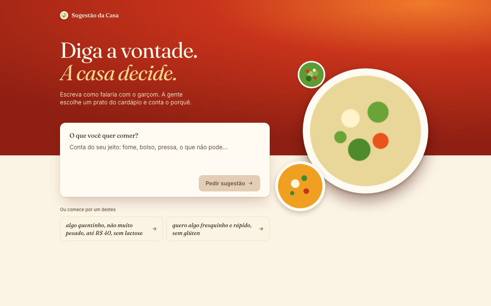
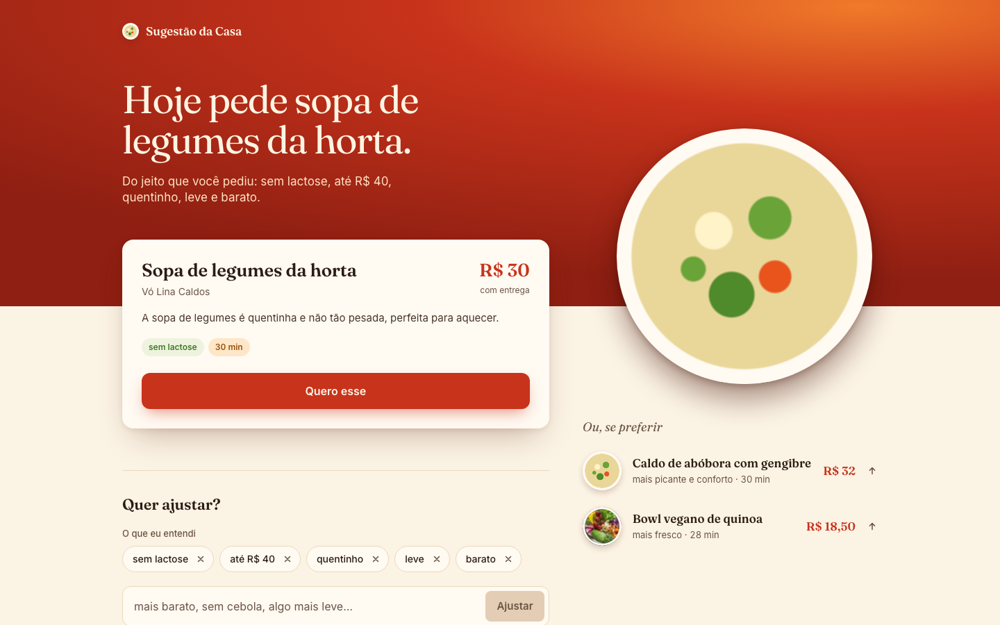
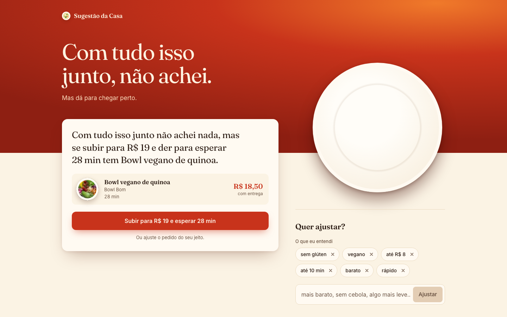
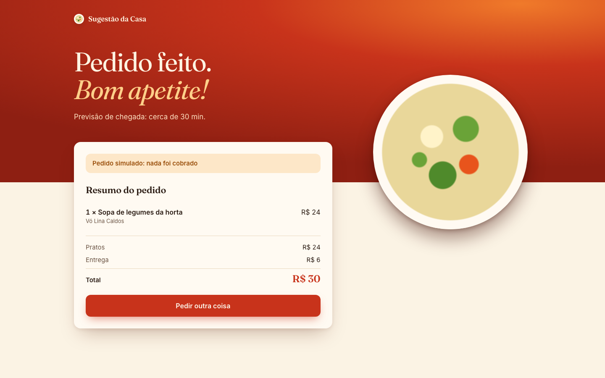
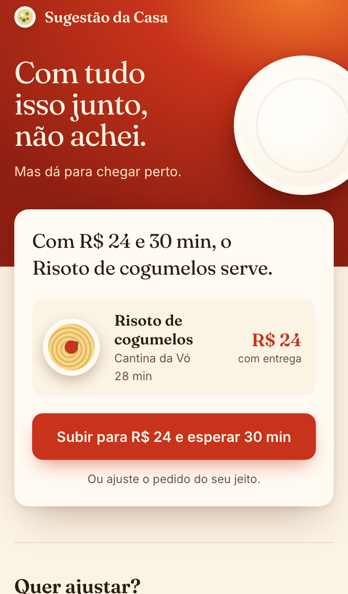
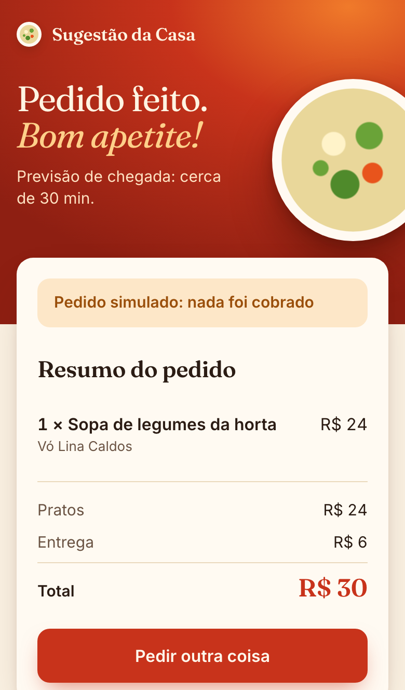

# Sugestão da Casa

Você abre o app de delivery com fome, rola 107 pratos e acaba pedindo o de sempre. A Sugestão da Casa inverte isso: você escreve como falaria com o garçom ("algo quentinho, não muito pesado, até R$ 40, sem lactose") e ela escolhe um prato do cardápio, conta o porquê e mostra duas alternativas. Se nada passa por todas as exigências, ela propõe o menor passo para chegar perto, como "subir para R$ 19 e esperar 28 min".

Projeto de portfólio. O cardápio é fictício (14 restaurantes, 107 pratos) e o pedido é simulado: nada é cobrado.

Link público: https://sugestao-da-casa.vercel.app

## Telas

| Início | Resultado |
| --- | --- |
|  |  |

| Sem resultado, com proposta | Pedido simulado |
| --- | --- |
|  |  |

No celular:

| Início | Resultado | Sem resultado | Confirmação |
| --- | --- | --- | --- |
|  |  |  |  |

Os screenshots foram tirados com o backend rodando contra o Ollama local (qwen2.5:7b). A tela de resultado veio do modo IA.

## Como funciona

O pedido sai do frontend (Next.js) para `POST /v1/sugestoes` no backend (FastAPI). Lá, quatro peças trabalham juntas.

1. **Agente com ferramenta.** O LLM recebe a frase e chama a ferramenta `buscar_pratos` com os critérios que entendeu (restrições, ingredientes excluídos, orçamento, tempo, alvos de temperatura, peso e picância, doce). Num segundo passo ele escreve a explicação e a frase da decisão sobre o resultado da busca.
2. **Guarda determinística.** Quem filtra e ranqueia o cardápio é código Python, não o modelo. Restrição alimentar, ingrediente excluído, orçamento e tempo são aplicados por regras, e o prato escolhido pelo modelo só vale se estiver entre os candidatos que a busca devolveu. Se ele errar o prato, a frase ou a explicação, o texto vira um texto pronto. O modelo ajuda a escolher e a falar, não decide o que é permitido.
3. **Rede de segurança por palavras-chave.** Um interpretador por palavras-chave lê a frase em paralelo e mescla com o que o modelo entendeu. Ele cobre falhas de interpretação do LLM e trata casos como "batata doce" (não é sobremesa) e "sem doce".
4. **Modo demonstração.** Se o LLM falha ou estoura o tempo, a resposta sai do interpretador por palavras-chave com textos prontos, e a tela mostra um selo avisando. A pessoa nunca fica sem resposta.

Quando nenhum prato passa, a guarda calcula a menor mudança de orçamento e tempo que traz um prato (`afrouxar`) e o frontend a oferece como um botão.

O frontend mostra o que foi entendido como etiquetas removíveis; remover uma etiqueta ou escrever "mais barato" refaz o pedido com os critérios ajustados, sem repetir tudo.

## Avaliação de provedores

Rodei 20 frases (`backend/evals/frases.jsonl`) contra dois modelos locais via Ollama e contra o modelo usado no site público (Groq). Os resultados completos estão em `backend/evals/resultados/`.

| Modelo | Sucesso no passo 1 | Restrições corretas | Guarda 100% | Escolha do modelo aceita | Latência p50 | Latência p95 |
| --- | --- | --- | --- | --- | --- | --- |
| Groq openai/gpt-oss-120b | 100% | 90% | sim | 100% | 2,5 s | 3,4 s |
| Ollama qwen2.5:7b | 90% | 85% | sim | 100% | 19,7 s | 25,3 s |
| Ollama llama3.2:3b | 45% | 35% | sim | 100% | 6,2 s | 14,1 s |

O modelo menor é mais rápido, mas erra o formato dos argumentos da ferramenta em mais da metade das frases, o que cai no modo demonstração. Por isso o padrão local é o qwen2.5:7b.

No site público o modelo é o `openai/gpt-oss-120b`, servido pela cota gratuita do Groq. Ele acertou o formato da ferramenta nas 20 frases e respondeu em 2,5 s (p50), contando os dois passos do agente. As duas frases que erraram as restrições esperadas foram "nada de frutos do mar hoje" (o modelo tratou "frutos do mar" como ingrediente, não como restrição) e "não como carne de porco nem camarão" (virou vegetariano, mais restritivo que o esperado).

Para repetir:

```bash
cd backend
uv run python -m evals.rodar --base-url http://localhost:11434/v1 --modelo qwen2.5:7b \
  --saida evals/resultados/ollama-qwen2.5-7b.json
```

## Como rodar local

Tudo roda sem serviços pagos.

Requisitos: [Ollama](https://ollama.com), [uv](https://docs.astral.sh/uv/) e Node.js.

```bash
# 1. Modelo local
ollama pull qwen2.5:7b

# 2. Backend (porta 8000)
cd backend
cp .env.example .env
CORS_ORIGENS='["http://localhost:3000"]' LLM_TIMEOUT_S=45 uv run uvicorn app.main:app --port 8000

# 3. Frontend (outro terminal, porta 3000)
cd frontend
npm install
NEXT_PUBLIC_TIMEOUT_MS=60000 npm run dev
```

Variáveis de ambiente:

| Variável | Onde | Para que serve |
| --- | --- | --- |
| `LLM_BASE_URL`, `LLM_API_KEY`, `LLM_MODEL` | backend | Endpoint compatível com a API da OpenAI. Padrão: Ollama local com `qwen2.5:7b`. |
| `LLM_TIMEOUT_S` | backend | Tempo máximo do agente antes de cair no modo demonstração. Padrão 8. Com Ollama local use 45. |
| `CORS_ORIGENS` | backend | Origens permitidas, em JSON. Padrão `["http://localhost:3000"]`. |
| `SUPABASE_URL`, `SUPABASE_ANON_KEY` | backend | Se vazias, o cardápio vem de `supabase/cardapio.json`. |
| `NEXT_PUBLIC_API_URL` | frontend | URL do backend. Padrão `http://localhost:8000`. |
| `NEXT_PUBLIC_TIMEOUT_MS` | frontend | Espera máxima pela resposta. Padrão 12000. Com Ollama local use 60000. |

Testes:

```bash
cd backend && uv run pytest -q && uv run ruff check .
cd frontend && npm test && npm run lint && npm run build && npm run test:e2e
```

Os testes de ponta a ponta (Playwright, desktop 1440x900 e iPhone 13) interceptam a API com respostas fixas e cobrem o fluxo principal, a proposta aceita quando não há resultado, o selo do modo demonstração, `prefers-reduced-motion` e o foco do carrinho (que é um `<dialog>` nativo). Eles sobem o frontend na porta 3100; se já houver um servidor ali, ele é reaproveitado.

## Decisões e limitações

- **Latência local.** O qwen2.5:7b no Ollama leva cerca de 20 s por resposta na minha máquina. É por isso que os tempos limite locais são altos (45 s no backend, 60 s no frontend). No site público, com o Groq, o padrão de 8 s e 12 s vale.
- **Cota gratuita do Groq.** O `openai/gpt-oss-120b` no plano gratuito permite 8 mil tokens por minuto e 200 mil por dia. Cada sugestão usa duas chamadas ao modelo, então em picos o site cai no modo demonstração em vez de travar.
- **Guarda no código, não no prompt.** Restrições alimentares não dependem de o modelo obedecer. A avaliação confirma a guarda em 100% das frases, mas só com os dois modelos testados.
- **"Sem frutos do mar" exclui peixe.** Para quem tem essa restrição, peixe também fica de fora (salmão, atum, tilápia, bacalhau e afins), além de crustáceos e moluscos.
- **Modo demonstração é mais simples.** Sem o LLM, a interpretação é por palavras-chave e os textos são prontos. O selo deixa isso claro.
- **Supabase só leitura.** No site público o cardápio vem de um projeto Supabase com as três migrations e o seed aplicados, RLS ativo e apenas leitura para `anon`. Sem credenciais (desenvolvimento local), o backend lê `supabase/cardapio.json`.
- **Cardápio fictício.** Restaurantes e pratos são inventados para a demonstração. Só 6 dos 107 pratos têm foto (Unsplash); os demais usam um prato desenhado.
- **Pedido simulado.** Não há pagamento nem integração com restaurantes.

## Deploy

O site roda em dois projetos na Vercel ligados a este repositório: o frontend (`frontend/`, Next.js) e o backend (`backend/`, FastAPI como Vercel Function). Cada push na `main` publica os dois. Para reproduzir em outra conta:

- Aplicar as três migrations de `supabase/migrations/` no projeto Supabase, em ordem.
- Rodar `supabase/seed.sql` (gerado por `python supabase/gerar_seed.py`).
- Configurar no backend `LLM_BASE_URL`, `LLM_API_KEY`, `LLM_MODEL`, `SUPABASE_URL`, `SUPABASE_ANON_KEY` e `CORS_ORIGENS` (com a origem do frontend publicado).
- Configurar no frontend `NEXT_PUBLIC_API_URL` com a URL pública do backend.

## Próximos passos

- Pedido em grupo, conciliando as restrições de várias pessoas.
- Pedir por voz.
- Avaliação sistemática com provedores hospedados, usando as mesmas 20 frases e as mesmas métricas.
- Reduzir o tamanho do prompt para caber mais sugestões por minuto na cota gratuita.
